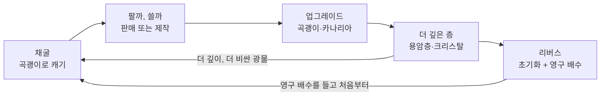
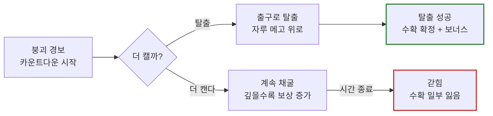

# 붕괴 광산 (Collapse Mine) 게임 기획서

> 세부 기획서입니다. 방향·목표는 [`direction.md`](direction.md)가 우선합니다.
> 섹션마다 담당이 있습니다 ([`README.md`](README.md)). 바꿀 때는 PR로 수정하고, 바뀐 결정은 결정 파일(팀 T- / 담당 A-·B-·C-)에 날짜와 이유를 남깁니다.
> 2026-10-29 회의 결정(압력 없앰, 곡괭이 레벨·룬 등, T-001~T-005)은 아직 아래 본문에 반영 전입니다. 해당 섹션 담당이 고칩니다.
>
> 최초 작성: 2026-10-21 (원본: https://claude.ai/artifact/CiZVh2TG9FXDNpoJmYJdUQ)

## 게임 소개

서버 전체가 함께 거대한 광맥을 파 내려가고, 언제 무너질지 모르는 광산에서 **더 캘까, 지금 탈출할까**를 고민하게 만드는 채굴 게임이다.

| 항목 | 내용 |
|---|---|
| 가제 | 붕괴 광산 (Collapse Mine) |
| 장르 | 채굴 시뮬레이터 + 서버 공동 이벤트 |
| 타깃 | 로블록스 전 연령, 짧게 자주 접속하는 플레이어 |
| 한 판 길이 | 붕괴 주기 1회 (구체 시간은 테스트로 결정) |
| 핵심 감정 | 희귀 광물이 터지는 순간의 쾌감, 붕괴 직전 탈출의 긴장감 |

**왜 이 게임인가**: 광산 채굴은 레드오션이지만 신작이 계속 뜨는 검증된 장르다. 우리는 검증된 채굴 루프 위에 "서버 공동 광맥 붕괴"라는 긴장 장치 하나를 얹어 차별화한다.

**숏폼 설계 원칙**: 전설 광물 등장, 붕괴 직전 탈출처럼 15초 클립으로 잘라 올리기 좋은 순간을 일부러 설계한다.

**맵 형태**: 땅 속 개미굴 모양 동굴. 입구 방 → 허브 방 무리 → 완만하게 내려가며 퍼지는 굴 여러 갈래, 굴 중간중간 방. 수직굴은 만들지 않는다 (붕괴 때 걸어서 올라올 수 있어야 함). → [D-001](decisions.md#d-001-맵은-개미굴-모양-대각선-동굴)

## 광산 구성

곡괭이 등급을 올리면 새 광산이 열린다. "다음 곡괭이를 사야 하는 이유"가 곧 성장 동기다. → [D-006](decisions.md#d-006-곡괭이-등급마다-다른-광산)

| 순서 | 광산 | 필요한 곡괭이 | 분위기 | 대표 광물 |
|---|---|---|---|---|
| 1 | 기본 광산 | 나무 곡괭이 | 갈색 흙 → 회색 바위 | 석탄, 구리, 석영, 호박석, 동굴 진주, 광부의 녹슨 등불 |
| 2 | 철광 갱도 | 돌 곡괭이 | 회색 바위 → 검은 철광층 | 철, 주석, 은, 자철석, 백금, 감독관의 회중시계 |
| 3 | 지하수 동굴 | 철 곡괭이 | 하얀 석회암 → 젖은 암반 | 석회석, 방해석, 남동석, 공작석, 물빛 진주, 젖은 광산 지도 |
| 4 | 용암 광산 | 금 곡괭이 | 붉은 균열, 열기 | 우라늄, 용암석 |
| 5 | 무너진 고대 도시 | 최상위 곡괭이 | 유적, 잔해 | ??? 등급 |
| 미정 | 별이 떨어진 곳 | 미정 (상위 등급) | 운석이 떨어진 밤의 분화구, 빛나는 광석 | 운석 파편, 별가루 원석, 성운석, 혜성 핵, 별빛 결정, 떨어진 별 → [D-010](decisions.md#d-010-새-광산-별이-떨어진-곳-광석-6종) |

2·3번은 공유 기획서 2·3스테이지대로 확정 (D-017). 4~5번 이름·광물은 예시이며 만들 때 확정한다. 광산 사이 이동은 허브 입구 대신 텔레포트로 한다 (D-017).

**구조**
- 한 장소(Place) 안에 광산 스테이지마다 지상 허브(판매소·제작소·랭킹판·광산 입구)가 하나씩 있고, 광산은 자기 허브에서 멀리 떨어진 곳에 짓는다 (D-019). 스테이지 사이는 텔레포트로 옮긴다. 허브의 광산 입구(포탈)를 밟으면 해당 광산 입구 방으로 이동하고, 광산 입구 방의 탈출 지점을 밟으면 허브로 돌아온다.
- 한 장소라서 서버 공지, 리더보드, 붕괴 이벤트를 한 서버에서 공유한다. 광산이 많아져 무거워지면 그때 광산별로 장소를 나눈다.
- 광산마다 층(지층)은 2~3개로 얕게, 대신 옆으로 넓게 만든다. 깊은 층의 테마(수정, 용암 등)는 다음 광산의 몫이다.
- **광산 하나 = 설정 한 줄**: 이름, 필요 곡괭이 등급, 위치·크기, 지층, 광물표, 붕괴 주기를 `src/shared/Config/Mines.luau`에 적으면 공통 코드와 생성기(`tools/generate_mine.luau`)가 그대로 돌아간다.
- **붕괴는 광산마다 따로**, 시간을 엇갈리게 둔다. 한 광산이 무너지는 동안 다른 광산으로 옮겨 가는 흐름과 "용암 광산 붕괴 30초 전!" 같은 서버 공지가 생긴다.

**허브와 입구**: 시작 지점은 사방이 절벽으로 둘러싸인 분지다. 광산 입구마다 뒤에 눈 덮인 봉우리가 솟은 산이 있고, 앞면 절벽에 거대한 동굴 아가리가 뚫려 있다. 광산 테마에 맞춰 산과 불빛 색이 달라진다(예: 용암 광산은 현무암 산과 붉은 균열). → [D-008](decisions.md#d-008-광산-입구는-웅장하게)

**기본 광산 (1번)**: 반경 약 350, 깊이 약 120, 지층 2개(흙층·바위층), 굴 12갈래와 곁가지, 방 약 150개. 광물은 공유 기획서 1스테이지 "흙 동굴" 6종(석탄·구리·석영·호박석·동굴 진주·광부의 녹슨 등불), 깊을수록 등급 높은 광물. → [D-007](decisions.md#d-007-기본-광산은-얕고-아주-넓게), [D-012](decisions.md#d-012-기본-광산-광물을-1스테이지-6종-모델로)

## 핵심 루프

광물을 캐고, 팔거나 쓰고, 더 깊이 내려가는 반복.

긴장이 생기는 지점은 "팔까, 쓸까"다. 에픽 이상 광물은 당장 팔면 돈이 되고, 모으면 다음 층을 여는 곡괭이가 된다. 붕괴된 광맥은 시간이 지나면 더 깊고 비싸게 다시 자라서, 오래 쉬었다 와도 들어갈 이유가 생긴다.

## 도파민 장치와 광물 도감

같은 광물을 캐도 매번 가치가 달라서, 곡괭이질 한 번 한 번이 작은 뽑기가 된다.

**등급 7단계**

| 등급 | 테두리 색 | 예시 광물 | 용도 |
|---|---|---|---|
| 일반 | 회색 | 석탄, 구리 | 판매, 곡괭이·가방 재료 (많이) |
| 고급 | 초록 | 석영, 은, 남동석 | 곡괭이·가방 재료 |
| 희귀 | 파랑 | 호박석, 자철석, 공작석 | 카나리아 먹이, 곡괭이 재료 (조금) |
| 에픽 | 보라 | 동굴 진주, 백금, 물빛 진주 | 곡괭이 핵심 재료(이름이 됨), 카나리아 위쪽 레벨 |
| 전설 | 주황 | 광부의 녹슨 등불, 감독관의 회중시계 | 판매, 도감 |
| 신화 | 빨강 | 해적선, UFO | 최상위 곡괭이 재료 |
| ??? | 비공개 | 아직 아무도 못 찾음 | 출시 후 첫 발견자 공개 |

광물 기본가 = 2 × 2.2^(스테이지 − 1) × 등급 배수 (일반 1·1.6, 고급 2.5, 희귀 6, 에픽 15, 전설 50, 신화 150). 곡괭이·가방·카나리아 업그레이드는 모두 코인 + 광물로 한다 → [D-044](decisions.md#d-044-경제-숫자를-공유-기획에-맞추고-업그레이드는-모두-코인--광물로)

**무게와 압력 등급**: 모든 광물은 캘 때 무게가 랜덤으로 정해지고, 캔 깊이와 붕괴까지 남은 시간에 따라 압력 등급이 붙는다.

> **판매가 = 기본가 × 무게 × 압력 배수**

- 상압: 얕은 곳, 평소에 캔 광물
- 고압: 깊은 곳이나 붕괴 경보 중에 캔 광물
- 초고압: 붕괴 직전 마지막 몇 초에 캔 광물, 가장 비쌈

더 버틸수록 비싸지므로, 압력 등급이 곧 "한 번만 더 캘까"의 이유가 된다.

**황당한 광물**: 보물상자, 공룡 뼈, 해적선, UFO처럼 땅에서 나올 리 없는 것이 나온다. "이게 왜 땅에서 나와?"라는 반응이 숏폼 소재가 된다.

**팔까 말까 고민**: 에픽 이상 광물은 판매도 되고 곡괭이 재료도 된다. 당장의 돈과 장기 성장 사이에서 매번 선택하게 만든다.

**발견 연출**: 전설 이상을 캐면 빛기둥, 화면 흔들림, 전용 사운드와 함께 서버 전체 공지가 뜬다.

*(참고 이미지: 광물 도감 예시 — 윗줄은 기본 광물, 아랫줄은 같은 루비의 상압·고압·초고압)*

## 차별화: 광맥 붕괴 이벤트

서버 공동 광맥이 일정 시간마다 붕괴 카운트다운에 들어가고, 모든 플레이어가 욕심과 생존 사이에서 고른다.

마지막까지 버티다 탈출한 사람은 추가 보상, 최하층을 처음 뚫은 사람은 서버에 이름 박제.

- 깊은 곳에 있을수록 캐는 광물의 가치가 커지지만, 출구까지 거리도 멀다.
- 갇히면 이번 판 수확의 일부만 잃는다. 전부 잃으면 어린 유저가 이탈하므로 비율은 테스트로 정한다.
- 붕괴 직전 탈출 장면은 숏폼 클립의 핵심 소재다.

**붕괴와 엮인 고유 장치**: 탐지·방치·가치 변동을 모두 붕괴 시스템에 묶어, 따로 붙인 기능이 아니라 한 테마로 읽히게 한다.

| 장치 | 역할 | 방식 | 붕괴와의 연결 |
|---|---|---|---|
| 광산 카나리아 | 희귀 광맥 탐지 + 펫 기능 | 펫 새가 벽 속에 숨은 희귀 광맥 근처에서 울고(그 근처를 파면 희귀 광물이 잘 나옴), 레벨이 오르면 탐지 범위가 넓어지고 헤드랜턴·출구 안내·광물 바꾸기·갇힘 보호가 하나씩 생김 → [D-036](decisions.md#d-036-카나리아는-숨은-희귀-광맥을-감지한다), [D-045](decisions.md#d-045-카나리아를-펫으로-레벨마다-기능과-장비가-하나씩) | 붕괴가 가까워지면 불안해하며 경보 역할도 함 |
| 광맥 재생 | 재접속 이유 | 붕괴된 광맥이 시간이 지나면 다시 자람, 오래 비울수록 더 깊고 비싼 광맥이 생김 | 붕괴가 끝이 아니라 다음 광맥의 시작 |
| 압력 등급 | 같은 광물도 가치 변동 | 깊이와 붕괴까지 남은 시간으로 상압·고압·초고압 결정 | 붕괴 직전에 캔 광물이 가장 비쌈 |

**맵 안의 광맥과 약한 지반**: 개미굴 굴·방 주변에 광맥이 몰려 있고, 광맥 근처는 지반이 약해 붕괴 위험이 더 크다 (좋은 광물은 위험한 곳에). → [D-002](decisions.md#d-002-광맥과-약한-지반)

*(참고 이미지: 붕괴 직전 — 자루를 메고 출구로 달리는 광부들, 끝까지 캐는 한 명)*

## 화면 예시

플레이어가 보는 화면은 채굴 시야를 가리지 않도록 정보를 가장자리에 모은다.

| 위치 | UI 요소 | 내용 |
|---|---|---|
| 위쪽 | 서버 공지 배너 | 전설 발견, 서버 부스트 구매, 붕괴 카운트다운 |
| 오른쪽 위 | 광산 카나리아 | 희귀 광맥 근처면 울고, 붕괴가 가까우면 불안해하는 펫 상태 |
| 왼쪽 | 현재 깊이 · 소지금 | 지금 몇 층인지, 붕괴 시 잃을 수 있는 수확량 |
| 아래 | 인벤토리 슬롯 | 캔 광물, 무게·변이 표시, 가방 용량 |
| 왼쪽 버튼 줄 | 🗺️ 광산 지도 | 스테이지(광산)를 골라 그 허브로 이동. 못 가는 광산은 잠금과 필요한 곡괭이 표시, 광산 안에서는 못 씀 → [D-042](decisions.md#d-042-스테이지-이동은-광산-지도로) |
| 지상 허브 | 판매소 · 제작소 · 랭킹판 | 판매, 곡괭이 제작, 랭킹 3종(최고 탈출 수확·최고 광물·누적 수입) → [D-009](decisions.md#d-009-랭킹은-깊이-대신-수확-기준-3종) |

*(참고 이미지: 채굴 화면 예시 — 어깨의 카나리아가 고압 광물을 알려주고, 위쪽은 공지 배너, 아래는 인벤토리)*

## 수익 모델

최강 장비는 무과금으로도 얻을 수 있게 하고, 로벅스는 시간을 줄여주는 데만 쓴다.

| 종류 | 상품 예시 | 특징 |
|---|---|---|
| 게임패스 (영구) | 자동 채굴, 채굴 속도 2배, 인벤토리 확장 | 50 / 150 / 400 / 1,000 로벅스처럼 가격대를 넓게 |
| 개발자 상품 (반복) | 행운 부스트 30분, 서버 전체 부스트 | 서버 부스트 구매 시 "OOO님이 서버 전체에 2배를 선물" 공지 |
| Creator Rewards | 플레이 시간 기반 자동 지급 | 붕괴 카운트다운, 출석 보상으로 체류 시간 확보 |
| 비공개 서버 | 친구끼리 광맥 독점 | 개발 비용 거의 없음 |

**원칙**

- 25~50 로벅스짜리 첫 결제 상품을 꼭 둔다.
- 랜덤 요소를 팔면 확률을 공개한다.
- 캔 광물을 로벅스나 현금으로 바꿔주는 구조, 플레이어끼리 로벅스 거래는 만들지 않는다 (로블록스 규정 위반).
- 첫 버전은 게임패스 2~3개 + 서버 부스트 1개로만 시작하고, 재방문율을 본 뒤 늘린다.

## 팀 역할

3명이 기능 단위로 나눠, 각자 맡은 기능의 서버·UI·연출·밸런스를 끝까지 책임진다.

| 담당 | 기능 | 책임 범위 |
|---|---|---|
| A | 플레이어 + 광산 + 채굴 | 캐릭터, 채굴 판정·손맛, 곡괭이 성능(파워·속도·강화 효과), 광물 155개 데이터·출현 확률·압력 등급, 광맥 생성·재생, OreSpot·포털, 붕괴 연출(갇힌 사람 화면 흔들림·낙석, D-040), 희귀 광물 연출 |
| B | 경제 | 인벤토리, 가방, 상점, 곡괭이 제작·강화 비용, 광물 판매가, 가격 밸런스, 광산 카나리아, 리버스, 데이터 저장 |
| C | 이벤트·서비스 | 광맥 붕괴 이벤트(타이머·경보·갇힘·탈출 보상), 서버 공지, 게임패스·부스트·결제, 리더보드, 출석·퀘스트, 튜토리얼, 친구 초대 |

**기능 간 이벤트 계약**: 서로의 코드를 직접 건드리지 않고 정해진 이벤트로만 주고받는다. 코드 정의는 `src/shared/Events.luau`, 보내고 받기는 `src/shared/EventBus.luau`.

| 이벤트 | 보내는 쪽 → 받는 쪽 | 담는 정보 |
|---|---|---|
| 데이터 로드됨 | B → 전체 | 플레이어 |
| 광물 획득됨 | A → B, C | 광물 종류, 무게, 압력 등급 |
| 전설 광물 발견됨 | A → C | 플레이어, 광물, 광산, 깊이 |
| 광산 입장함 | A → C | 플레이어, 광산 |
| 광물 가방에 담김 | B → C | 플레이어, 광물, 확정 가격 |
| 광물 판매됨 | B → C | 플레이어, 광물, 개수, 판매액 |
| 탈출 수확 확정됨 | B → C | 플레이어, 광산, 수확 가치 |
| 곡괭이 구매·강화됨 | B → A, C | 플레이어, 곡괭이 단계, 강화 단계 |
| 붕괴 경보 | C → A, B | 광산, 붕괴 시각 |
| 붕괴 발생 | C → A, B | 광산 |
| 탈출 성공 · 갇힘 | C → B | 플레이어, 광산 |
| 퀘스트 완료 · 출석 보상 | C → B | 플레이어, 보상 |

부스트·게임패스 효과는 이벤트 대신 C의 조회 함수(`Payments.GetMultiplier` 등)로 묻는다. → [D-011](decisions.md#d-011-역할-분담-최신화와-이벤트-계약-정리)

**미리 정할 것**

- [ ] 게임을 로블록스 그룹 소유로 만들고 그룹 오너 정하기
- [ ] 수익 배분 비율을 글로 남기기
- [ ] 의견이 갈릴 때 최종 결정권자 정하기
- [ ] 밸런스 숫자 전체를 보는 담당 1명 정하기
- [ ] 색상·폰트·이펙트 스타일 가이드 합의

## 개발 방식과 로드맵

1~2주 안에 핵심 루프만 담은 첫 버전을 내고, 반응을 보며 붕괴 이벤트와 상품을 늘린다.

**개발 방식**

| 영역 | 방식 |
|---|---|
| 코드 | Rojo + Git, 기능 폴더별 담당, PR은 올린 사람이 직접 머지 (D-015) |
| 기획 | 이 문서(`docs/`)를 Git으로 관리, 변경은 PR + 팀에 알림, 결정은 `decisions.md`에 기록 |
| 맵 | 스튜디오 팀 크리에이트, 광맥은 가능한 한 코드로 절차적 생성 (`tools/`) |
| 밸런스 | 스프레드시트 → shared 데이터 파일로 변환 |
| 보안 | 확률, 판매가, 결제 검증은 모두 서버에서 처리 |
| 배포 | 매주 금요일 업데이트 |

**로드맵**

1. **1단계 · 첫 출시 (1~2주)**: 채굴, 판매, 곡괭이 업그레이드, 광물 등급·압력 등급, 게임패스 2~3개
2. **2단계 · 반응 확인 (2~4주)**: 재방문율과 체류 시간 측정, 숏폼 업로드 시작, 전체 연령 공개 심사 진행
3. **3단계 · 차별화 (재방문율이 나오면)**: 광맥 붕괴 이벤트, 광산 카나리아, 서버 공지, 리더보드, 서버 부스트
4. **4단계 · 확장**: 광맥 재생, 리버스, 새 레이어, ??? 등급 공개 이벤트

**출시 전 참고**: 16세 이상 대상 출시는 무료다. 전체 연령으로 열려면 Plus·Premium 구독 2개월 또는 1,000 로벅스 환급형 수수료, 그리고 활동성 높은 플레이어 250명 심사가 필요하다.
